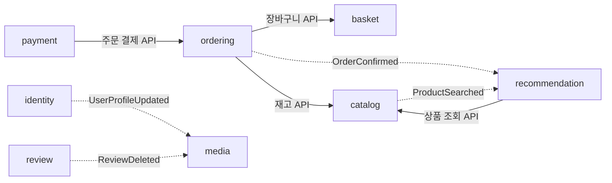
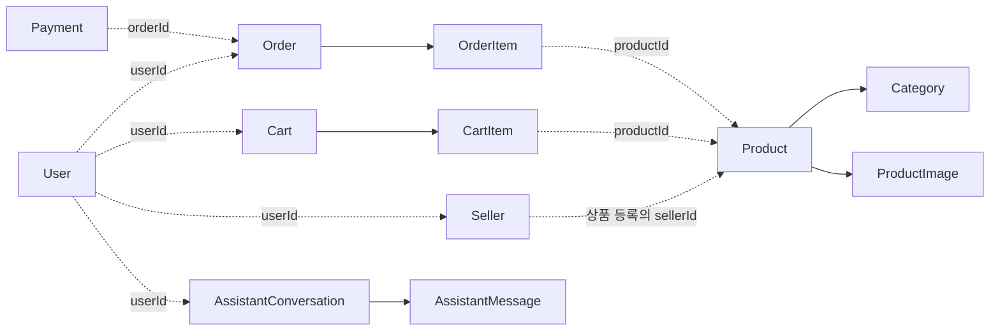

# Pagopa

상품 조회, 장바구니, 주문·취소, 결제, 상품 추천과 AI 고객 지원을 구현하는 이커머스 프로젝트입니다. 주문·결제·재고의 상태와 트랜잭션 경계, 도메인별 모듈 협력, 이벤트 중복 처리와 관리자·판매자 운영 화면을 함께 개발하고 있습니다.

- 개발 기간: 2026.03~진행 중
- 개발 형태: 개인 프로젝트
- 문서 확인 기준: 2026.10.26
- [대상 테스트 실행 기록](docs/validation.md): 2026.10.10 기준 동시성 12개를 포함한 28개 테스트 통과

## 구현 기능

| 영역 | 주요 기능 |
| --- | --- |
| 인증·운영 권한 | Spring Security, OAuth2 로그인, JWT 인증·토큰 재발급, 사용자·관리자·판매자 접근 경로 분리 |
| 상품·판매자 | 상품 조회·검색, 판매자 상품 등록·재고 관리, 판매자 전용 로그인·관리 화면 |
| 관리자 | 사용자 상태·역할 관리, 판매자 신청 승인·거절, 카테고리 관리 화면 |
| 장바구니·주문 | 장바구니 및 상품 바로 주문, 주문 항목·배송 정보, 주문 취소와 재고 복구 |
| 결제 | 승인·취소 흐름, 멱등 키, 내부 테스트 게이트웨이, Toss Payments 승인·취소 어댑터 |
| 추천 | 검색·주문 확정 이벤트를 통한 관심도 집계와 상품 추천 |
| AI 고객 지원 | 대화·메시지 이력, 일반·SSE 스트리밍 응답, Ollama 기반 생성, Elasticsearch RAG 지식 검색 |
| 이미지 | 공통 이미지 서비스, Azure Blob·Supabase Storage 구현체, 프로필·리뷰 삭제 이벤트 기반 정리 |

결제 게이트웨이는 `local`, `test` 프로필에서 내부 구현체를 사용하고, 그 밖의 프로필에서는 Toss Payments 어댑터를 사용합니다. Toss 어댑터는 승인·취소·결과 조회와 오류 응답 변환을 구현했지만, 이 문서에 연결된 대상 테스트 기록에는 실제 Toss Payments 호출 검증이 포함되지 않습니다.

AI 고객 지원은 Spring AI의 JDBC 대화 메모리와 Ollama 채팅·임베딩 모델을 사용합니다. RAG를 활성화하면 클래스패스의 정책·FAQ 문서를 Elasticsearch Vector Store에 동기화해 답변 근거로 사용합니다.

## 기술 스택

| 구분 | 기술 |
| --- | --- |
| 런타임·프레임워크 | Java 25, Spring Boot 4.0.4, Spring Modulith 2.0.8 |
| 인증·데이터 접근 | Spring Security, OAuth2, JWT, JPA, QueryDSL |
| AI·검색 | Spring AI 2.0.1, Ollama, Elasticsearch Vector Store, JDBC Chat Memory, SSE |
| 데이터베이스·마이그레이션 | MySQL, Elasticsearch, Flyway |
| 서버 렌더링 UI | Thymeleaf, HTMX, Tabler |
| 검증 | JUnit 5, Testcontainers(MySQL·Elasticsearch), Spring Modulith 모듈 검증 |
| 이미지 저장소 | Azure Blob Storage, Supabase Storage의 S3 API(AWS SDK for Java) |
| 개발·운영 도구 | Gradle Wrapper 9.4.0, Docker, GitHub Actions, Swagger, Prometheus, Grafana, EFK Stack |

저장소 구현체는 `app.storage.provider.type` 설정으로 선택하며 현재 기본값은 `supabase`입니다. 각 저장소 설정은 선택한 provider에서만 활성화됩니다. Supabase 구현체는 S3 호환 API를 호출하며, [지원되는 S3 API](https://supabase.com/docs/guides/storage/s3/compatibility)를 기준으로 사용합니다. 실제 클라우드 업로드·삭제는 아래 대상 테스트의 검증 범위에 포함되지 않습니다.

## 모듈 구조

애플리케이션은 하나의 Spring Boot 프로세스 안에서 도메인별 모듈을 분리합니다. 다른 도메인과의 협력에는 공개 API와 이벤트를 사용하며, 모듈 의존 관계를 테스트로 검사합니다.

| 모듈 | 책임 |
| --- | --- |
| `identity` | 사용자·역할·인증 |
| `catalog` | 상품·카테고리·재고 |
| `merchant` | 판매자 |
| `basket` | 장바구니 |
| `ordering` | 주문·주문 항목·취소 |
| `payment` | 결제 요청·승인·취소 |
| `review` | 상품 리뷰 |
| `discovery` | 조회·검색 흐름 |
| `recommendation` | 이벤트 기록·관심도 집계·추천 조회 |
| `assistant` | AI 대화·메시지 이력, 응답 생성, 지식 동기화와 RAG |
| `media` | 이미지 저장·삭제 |
| `global` | 공통 응답·예외·설정 |

다음은 주문과 추천의 주요 협력 흐름입니다. 전체 모듈 의존 그래프를 대신하지는 않습니다.



## 핵심 데이터 관계

아래 관계도는 엔티티의 주요 연결을 읽기 쉽게 요약한 것입니다. 점선은 ID로 참조하는 모듈 간 관계, 실선은 모듈 내부 JPA 관계를 나타냅니다. 점선 관계에 데이터베이스 외래 키가 존재한다는 뜻은 아닙니다.



상품 등록 흐름에서 전달하는 판매자 ID는 현재 `Product.userId` 필드에 저장됩니다.

주문 항목은 상품 ID와 함께 상품명·주문 가격·수량을 저장합니다. 주문 시점의 정보와 현재 상품 정보를 분리해 표현합니다.

## 주요 설계

### 동시 주문과 재고 복구

상품 재고와 주문 상태 변경에 비관적 잠금을 사용합니다. 여러 상품의 재고를 변경할 때는 상품 ID 순서로 잠금을 획득합니다. 중복 상품 항목은 수량을 합산해 처리합니다.

같은 상품의 동시 주문과 같은 주문의 동시 취소를 비롯한 네 가지 시나리오를 각각 50·200·1,000개 동시 요청으로 실행했습니다. 초과 판매 방지, 한 번만 취소되는 주문, 최종 재고 복구를 검증했습니다. 구체적인 성공 조건은 [검증 기록](docs/validation.md)에 정리했습니다.

### 결제 승인·취소

게이트웨이 호출과 DB 상태 변경의 트랜잭션 경계를 분리하고, 승인·취소 중간 상태와 멱등 키를 사용하도록 구성했습니다. 외부 호출이 명시적으로 거절되면 상태를 실패 또는 이전 상태로 전환하고, 타임아웃처럼 결과가 불명확하면 중간 상태를 유지합니다.

`local`, `test`에서는 메모리 기반 내부 게이트웨이를 사용합니다. 다른 프로필의 Toss Payments 어댑터는 결제 승인·취소 API 호출, 결제 키·주문 ID 조회, 응답 검증과 거절/불명확 오류 구분을 담당합니다.

### 이벤트 기반 추천

상품 검색과 주문 확정 이벤트를 받아 관심도를 갱신합니다. 검색 키워드는 정규화하고, 주문의 상품 ID는 중복을 제거합니다. 현재 검색은 관심도 1, 주문 상품은 관심도 5를 추가합니다.

이벤트 ID 중복 확인과 관심도 갱신을 같은 트랜잭션에서 처리합니다. 이미 처리한 이벤트는 집계를 반복하지 않습니다. 추천 조회는 관심 상품, 관심 키워드의 후보, 기본 상품 순서로 후보를 모으고 중복·비활성·품절 상품을 걸러냅니다.

### AI 대화와 RAG

사용자별 대화와 메시지 이력을 MySQL에 저장하고, Spring AI의 JDBC Chat Memory에는 최근 12개 메시지를 유지합니다. 일반 응답과 SSE 스트리밍 응답을 모두 제공하며, 모델 오류는 저장된 메시지 상태에 반영합니다.

관리자 API로 정책·FAQ Markdown 문서를 전체 또는 소스별로 동기화합니다. 문서를 토큰 단위로 나눠 Ollama 임베딩을 생성하고 Elasticsearch에 저장하며, 질문 시 유사도 기준을 통과한 문서를 답변 근거로 사용합니다.

### 운영 화면과 이미지 수명 주기

관리자 화면은 사용자 상태·역할, 판매자 신청, 카테고리를 관리합니다. 판매자 화면은 별도 Google OAuth2 로그인과 `SELLER` 권한 검사를 거쳐 상품 조회·등록·재고 추가 기능을 제공합니다.

프로필 이미지 변경과 리뷰 삭제는 모듈 이벤트를 발행합니다. `media` 모듈은 이벤트를 받아 이전 프로필 이미지와 리뷰에 연결된 이미지를 저장소에서 정리합니다.

## 로컬 실행

### 준비 사항

- Java 25 및 프로젝트의 Gradle Wrapper
- 정상 실행 중인 Docker: Testcontainers 검증에 사용
- 로컬 서버 실행 시 접근 가능한 MySQL과 환경 설정
- AI 고객 지원 사용 시 Ollama와 Elasticsearch, 설정한 채팅·임베딩 모델

현재 기본 설정은 `spring.jpa.hibernate.ddl-auto=none`입니다. 빈 데이터베이스에서는 Flyway의 `B5` 기준 마이그레이션이 사용자·상품·주문·결제·추천·AI 대화 등 전체 기준 스키마를 만들고, 이후 `V6`, `V7` 변경을 순서대로 적용합니다. 기존 데이터가 있으면서 Flyway 이력 테이블이 없는 데이터베이스는 `FLYWAY_BASELINE_ON_MIGRATE`의 기본값이 `false`이므로 별도의 기준선 설정과 사전 검토가 필요합니다.

테스트 프로필은 별도의 설정과 Testcontainers를 사용합니다. 기존 서비스 DB를 테스트 DB로 지정할 필요가 없습니다.

저장소의 Docker Compose는 Elasticsearch·Ollama와 모니터링 스택을 제공하지만 MySQL은 포함하지 않습니다. AI 의존성만 먼저 실행하고 기본 모델을 준비하려면 다음 명령을 사용합니다.

```powershell
docker compose up -d elasticsearch ollama
docker compose exec ollama ollama pull qwen3:4b
docker compose exec ollama ollama pull qwen3-embedding:0.6b-q8_0
```

### 환경 설정

실제 값은 실행 환경에서 설정합니다. 설정 이름과 기본값의 기준은 `src/main/resources/application.yml`입니다.

| 영역 | 주요 환경 변수 |
| --- | --- |
| DB | `DB_URL`, `DB_USERNAME`, `DB_PASSWORD` |
| JWT | `JWT_SECRET`, `JWT_ACCESS_TOKEN_EXPIRY`, `JWT_REFRESH_TOKEN_EXPIRY` |
| OAuth2 | `GOOGLE_CLIENT_ID`, `GOOGLE_CLIENT_SECRET`, `GOOGLE_ADMIN_CLIENT_ID`, `GOOGLE_ADMIN_CLIENT_SECRET`, `KAKAO_CLIENT_ID`, `KAKAO_CLIENT_SECRET`, `NAVER_CLIENT_ID`, `NAVER_CLIENT_SECRET` |
| 이미지 공통 | `IMAGE_ALLOWED_TYPES`, `IMAGE_MAX_SIZE` |
| Azure 저장소 | `AZURE_STORAGE_ACCOUNT_NAME`, `AZURE_STORAGE_ACCOUNT_KEY`, `AZURE_STORAGE_BASE_URL`, `AZURE_STORAGE_BLOB_ENDPOINT`, `AZURE_STORAGE_CONTAINER_NAME` |
| Supabase 저장소 | `SUPABASE_PROJECT_URL`, `SUPABASE_STORAGE_ACCESS_KEY`, `SUPABASE_STORAGE_SECRET_KEY`, `SUPABASE_STORAGE_BUCKET`, `SUPABASE_STORAGE_ENDPOINT`, `SUPABASE_STORAGE_REGION` |
| AI·RAG | `OLLAMA_BASE_URL`, `OLLAMA_CHAT_MODEL`, `OLLAMA_EMBEDDING_MODEL`, `OLLAMA_TEMPERATURE`, `ELASTICSEARCH_URIS`, `ASSISTANT_RAG_ENABLED`, `ASSISTANT_RAG_TOP_K`, `ASSISTANT_RAG_THRESHOLD`, `RAG_INDEX_NAME`, `RAG_INDEX_INITIALIZE` |
| Toss Payments | `TOSS_SECRET_KEY`, `TOSS_BASE_URL`, `TOSS_SUCCESS_URL`, `TOSS_FAIL_URL` |
| Flyway | `FLYWAY_BASELINE_ON_MIGRATE` |
| 웹 요청 | `SERVER_PORT`, `CORS_ALLOWED_ORIGINS`, `OAUTH2_REDIRECT_URL` |

이미지 저장소 provider와 실행 프로필에 맞는 변수만 실제 값으로 설정합니다. 비로컬 프로필은 Toss Payments 어댑터를 활성화하므로 `TOSS_SECRET_KEY`가 필요합니다. 결제·시드·작업 주기와 AI 모델의 전체 기본값은 같은 설정 파일에서 확인할 수 있습니다.

스키마와 환경 설정을 준비한 뒤 Windows에서는 다음과 같이 실행합니다.

```powershell
.\gradlew.bat bootRun --args="--spring.profiles.active=local"
```

macOS·Linux에서는 같은 인자에 `./gradlew`를 사용합니다.

### 기존 대상 테스트 기록

2026.10.10, 커밋 `dbf57d4d307615fa7cf4729096c316277a06ab66`에서 실제 실행한 Windows 명령입니다.

```powershell
.\gradlew.bat test --tests '*StockConcurrencyTest' --tests '*ApplicationModulithTest' --tests '*RecommendationProjectionServiceTest' --tests '*RecommendationQueryServiceTest' --tests '*RecommendationFlowIntegrationTest' --no-daemon --console=plain
```

결과: **28개 통과, 실패 0개, 오류 0개, 건너뜀 0개**. 전체 테스트 스위트나 실제 HTTP 처리량을 측정한 결과가 아닙니다. 이 기록 이후 추가된 판매자 화면·AI/RAG·Toss Payments 어댑터의 현재 테스트 결과도 포함하지 않습니다.

GitHub Actions에는 Java 25 환경의 `./gradlew clean build --no-daemon --stacktrace`가 구성되어 있습니다. 이 문서의 통과 결과는 위 로컬 대상 테스트에서 확인한 내용입니다.
